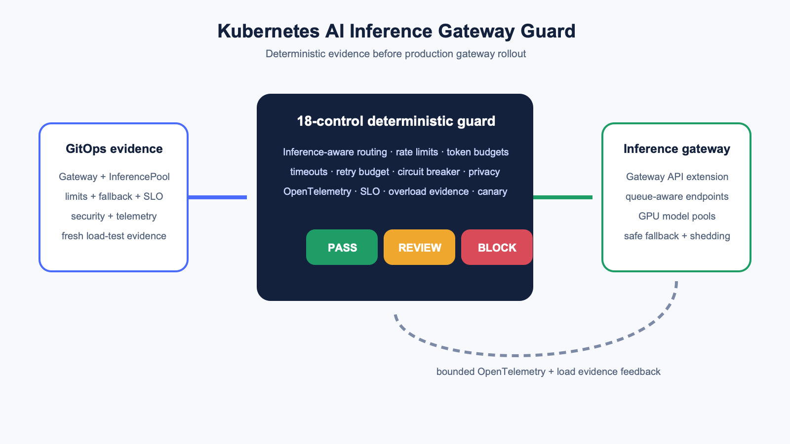

# Kubernetes AI Inference Gateway Guard

A deterministic GitOps policy gate for production Kubernetes AI inference gateways. It evaluates 18 controls across inference-aware routing, overload protection, security, OpenTelemetry, SLOs, load evidence, and rollout safety, returning `PASS`, `REVIEW`, or `BLOCK`. An optional AI explainer may summarize findings, but it cannot change the decision.



## Production problem

LLM traffic is long-running, expensive, and partly stateful. Ordinary round-robin routing cannot see queue depth, loaded adapters, KV-cache locality, token cost, or request criticality. Without bounded concurrency, layered rate limits, timeouts, circuit breakers, privacy controls, and fresh overload evidence, a gateway can turn a burst or backend failure into GPU saturation, retry storms, cross-tenant unfairness, or an SLO incident.

## Demand rationale

Kubernetes' Gateway API Inference Extension standardizes model-aware endpoint selection. Envoy Gateway documents coordinated global limits and fast local limits as separate protections. Current AI-infrastructure, SRE, and cloud-inference roles repeatedly ask for Kubernetes, high-scale serving, gateways, identity, observability, distributed systems, and production troubleshooting. See [research notes](docs/research.md) for the authoritative sources and live postings checked on 2026-11-13.

## What the guard proves

- Stable Gateway API plus `InferencePool`/`InferenceModel` evidence
- TLS, OIDC or mTLS, deny-by-default authorization, egress controls, signed images
- Queue- or KV-cache-aware routing with bounded request criticality
- Compatible single-hop fallback with overload shedding
- Global and local rate limits, token/concurrency budgets, timeouts, circuit breaking, and a small retry budget
- Bounded OpenTelemetry metrics for latency, queueing, tokens, saturation, errors, fallbacks, and rejected traffic
- SLO, zone-spread, disruption, fresh load-test, canary, rollback, and human-approval evidence

## Run locally

```bash
python -m venv .venv
source .venv/bin/activate
pip install -e . pytest
pytest
inference-gateway-guard samples/compliant-gateway.yaml --as-of 2026-11-13
inference-gateway-guard samples/unsafe-gateway.yaml --as-of 2026-11-13 --output json
```

The compliant sample scores 100% across 18 controls. The unsafe sample returns `BLOCK` and exit code `2`, making it suitable for CI and policy checks.

## Measurable outcomes

- 100% deterministic control coverage for production gateway contracts
- At least 95% overload-rejection accuracy in representative load tests
- p95 inference latency at or below 2.5 seconds and availability at or above 99.9%
- Retry budget at or below 5%, one-hop fallback, and bounded token/concurrency ceilings
- Fresh evidence for burst, backend failure, fallback, rate-limit, and zone-loss scenarios
- Lower mean time to identify unsafe routing or overload policy before deployment

## Deployment, security, and failure modes

Adopt in audit mode, compare contracts with live gateway state, validate with representative non-production traffic, then canary enforcement on at most 10% of traffic. The guard never mutates a cluster. Do not place prompts, responses, secrets, or customer data in contracts. Local limits multiply across proxy replicas, retries can amplify overload, fallbacks can share a failure domain, and stale routing metrics can produce worse choices. See the [safe deployment guide](docs/deployment.md).

## Interview positioning

This project demonstrates how I translate a current AI-platform problem into deterministic policy, tests, CI, security controls, observability requirements, measurable SLO outcomes, and a safe rollout. I can explain why inference routing differs from web load balancing, when to combine global and local limits, how retry and fallback policies fail under overload, and why an AI explanation layer must not override enforcement.
