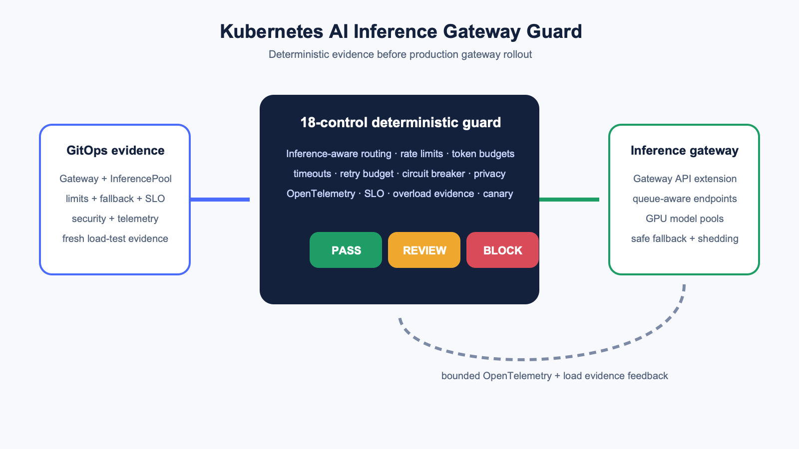

# Governing Kubernetes AI Inference Gateways Before Production

AI inference gateways fail differently from ordinary web gateways. A single request can occupy scarce GPU capacity for seconds, carry thousands of tokens, depend on KV-cache locality, and stream output long after the initial connection. If a platform uses round-robin routing, unbounded retries, weak timeouts, or a fallback that shares the same failure domain, a traffic burst can become a reliability and cost incident.

That matters now because the Kubernetes Gateway API Inference Extension is standardizing model-aware routing while current AI-infrastructure and SRE roles increasingly expect Kubernetes, high-scale model serving, gateways, identity, observability, and production troubleshooting.

## The production problem

Traditional gateways do not understand model identity, request criticality, queue depth, loaded adapters, token cost, or backend accelerator saturation. Rate limiting alone is not enough: local limits multiply across replicas, global limits add a dependency, retries amplify load, and a fallback can simply move the outage.

## The project

I built the **Kubernetes AI Inference Gateway Guard**, a deterministic 18-control policy gate for GitOps review. A version-controlled YAML contract describes the gateway, inference routing, overload protection, security, telemetry, SLOs, validation evidence, and operations ownership. The result is `PASS`, `REVIEW`, or `BLOCK`.

The control path is deliberately non-AI. An optional AI layer may explain a finding, but it cannot weaken a limit, approve a rollout, or change the decision.

## Architecture and implementation

GitOps evidence enters the Python guard before a production gateway rollout. The guard checks stable Gateway API and inference-extension resources; queue- or KV-cache-aware routing; criticality isolation; compatible single-hop fallback; layered global and local limits; token, concurrency, timeout, circuit-breaker, and retry budgets; privacy and supply-chain controls; bounded OpenTelemetry; SLOs; fresh load evidence; and a canary with rollback and human approval.

The repository includes compliant and intentionally unsafe contracts, a CLI with machine-readable output, 20 deterministic tests, GitHub Actions CI, a non-root Docker image, research notes, and safe deployment guidance.

## Validation and measurable outcomes

The compliant sample passes all 18 controls. The unsafe sample blocks. Individual regression tests prove each enforcement rule fails independently, while missing operational metadata produces `REVIEW` rather than silently approving or blocking.

Evaluation criteria include at least 95% overload-rejection accuracy, p95 inference latency at or below 2.5 seconds, 99.9% availability, a retry budget at or below 5%, one-hop fallback, and fresh burst, backend-failure, fallback, rate-limit, and zone-loss evidence.

## Deployment and operations

Begin in audit mode and compare contracts with live gateway state. Run representative traffic only in an isolated non-production environment with cost, duration, and concurrency ceilings. Canary enforcement on at most 10% of traffic, monitor error-budget burn and fallback use, and automatically roll back while keeping a human approval gate.

The project never changes a cluster. Envoy or another Gateway API implementation, a coordinated rate-limit service, secrets, telemetry storage, and admission integration remain explicit production extensions.

## Security and failure modes

Contracts must not contain prompts, responses, credentials, or customer data. Prompt-payload logging is disabled; attributes are bounded and redacted. Clients and model endpoints are authenticated, authorization is deny-by-default, egress is allowlisted, and images are signed.

The main trade-offs are operational: global limits need shared state, local limits reset and multiply, aggressive timeouts can break valid streams, retries can create storms, and stale routing metrics can make inference-aware placement worse than simple balancing.

## Interview positioning

This project gives me a concrete way to discuss Kubernetes Gateway API, AI serving, SRE, overload control, security, OpenTelemetry, CI policy, and safe rollout design. It shows that I can connect current infrastructure demand to a production problem, choose deterministic enforcement over AI authority, and define measurable reliability evidence.

Repository: https://github.com/ohjeffkuston/kubernetes-ai-inference-gateway-guard
